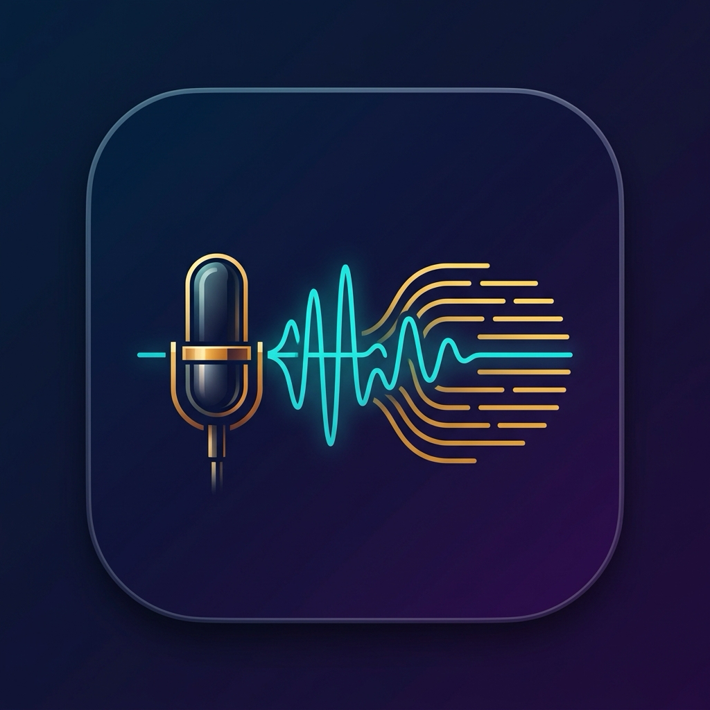
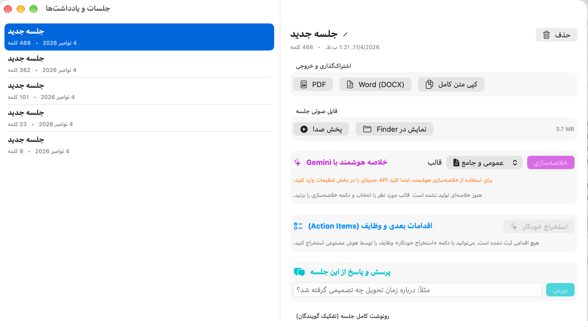
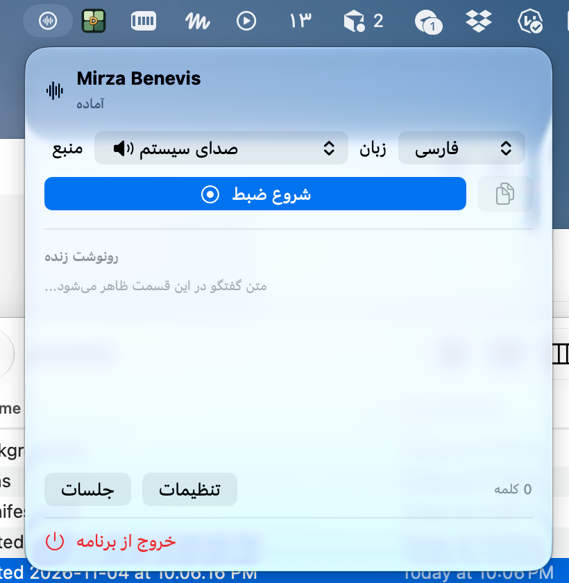
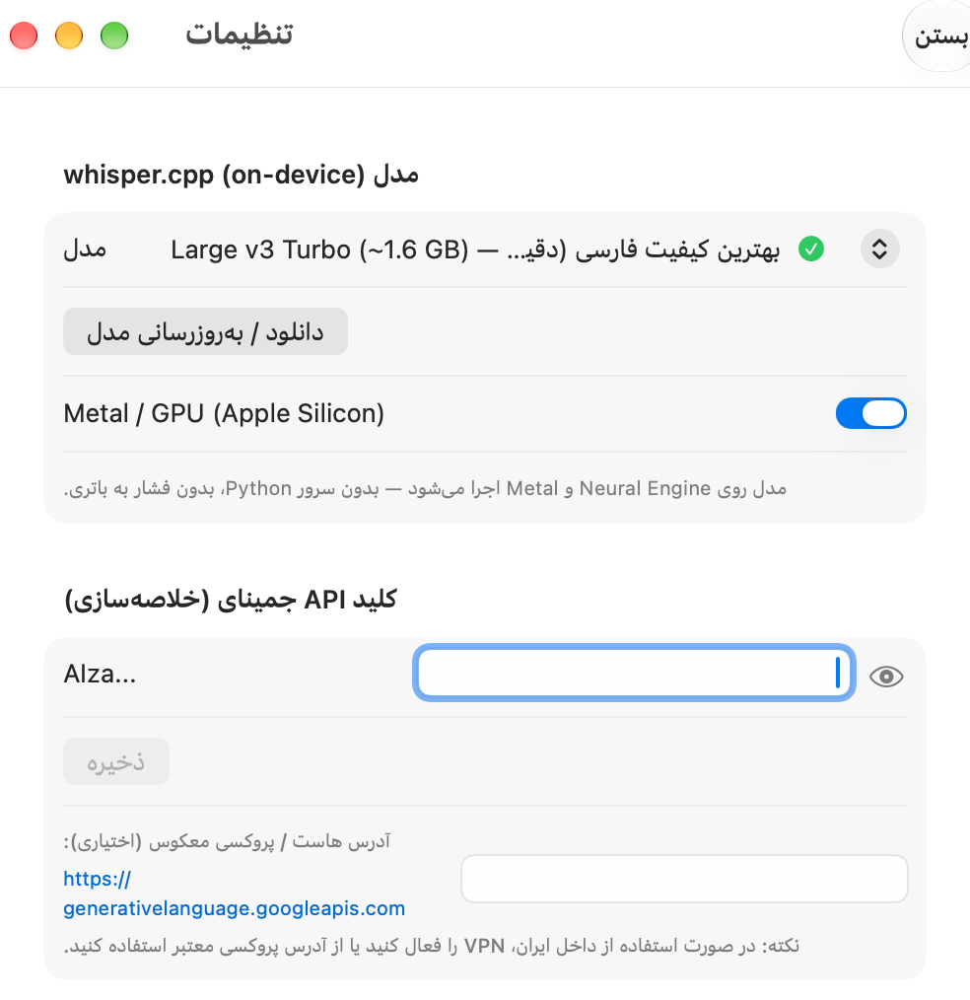

<p align="center">
  
</p>

<h1 align="center">Mirza Benevis (میرزا بنویس)</h1>

<p align="center">
  <b>دستیار هوشمند، بومی و کاملاً محرمانه جلسات در مک‌او‌اس (macOS)</b><br>
  تبدیل صوت به متن فارسی • تفکیک خودکار گویندگان • استخراج وظایف (Action Items) • خلاصه‌سازی و چت با محتوای جلسه
</p>

<p align="center">
  <a href="https://github.com/amirHHP/mirzabenevis-recorder3/releases/latest">
    
  </a>
  
  
  
  
  <a href="LICENSE">
    
  </a>
  <a href="https://pay.theminiceo.ir/link/783576">
    
  </a>
</p>

---

## ⚡ نوت‌برداری دستی سر جلسات را برای همیشه فراموش کنید!

آیا سر جلسات کاری در **Google Meet**، **Zoom**، **Slack** یا تماس‌های آنلاین، تمرکزتان مدام بین گوش دادن، تحلیل و یادداشت‌برداری خرد می‌شود؟ 

**میرزا بنویس** دستیار بومی و مقیم منوبار شما در مک است. این برنامه بدون نیاز به ورود هیچ ربات مزاحمی به جلسه و **بدون ارسال حتی یک بایت صدا به اینترنت**، صدای دوطرفه جلسه (اسپیکر همکاران + صدای میکروفون شما) را با بالاترین دقت زبان فارسی می‌شنود، رونوشت کلمه‌به‌کلمه تهیه می‌کند، گویندگان را تفکیک کرده و صورت‌جلسه، وظایف و خروجی‌های PDF و Word را برای شما آماده می‌سازد.

<br>

<p align="center">
  <a href="https://github.com/amirHHP/mirzabenevis-recorder3/releases/latest">
    
  </a>
</p>

<p align="center">
  <sub>بدون نیاز به ابزارهای جانبی • سازگار با مک‌های Apple Silicon (M1-M4) و پردازنده‌های Intel</sub><br>
  <sub>🔗 <a href="https://github.com/amirHHP/mirzabenevis-recorder3/releases">صفحه تمام ریلیزها در گیت‌هاب</a> | 💻 <a href="#-روش-دوم-نصب-از-طریق-گیت-و-سورس-کد-پیشنهادی-برای-دریافت-مداوم-آپدیت‌ها">نصب و آپدیت سریع از طریق گیت</a></sub>
</p>

---

## 📸 نمای محیط برنامه

### ۱. پنجره جلسات و یادداشت‌ها: خلاصه هوش مصنوعی، استخراج وظایف و رونوشت کامل
تمام جلسات شما مرتب و منظم آرشیو می‌شوند. می‌توانید با هوش مصنوعی چت کنید، وظایف را تیک بزنید یا خروجی Word و PDF دریافت کنید.

<p align="center">
  
</p>

<br>

### ۲. منوبار سریع و تنظیمات پیشرفته مدل‌های لوکال (On-Device)

| منوبار سبک و بی‌مزاحمت (شروع ضبط با ۱ کلیک) | تنظیمات مدل هوش مصنوعی Whisper و شتاب‌دهنده Metal |
|:---:|:---:|
|  |  |
| دسترسی فوری از بالای صفحه بدون اشغال پنجره‌های کاری | انتخاب مدل‌ها از Tiny تا Large Turbo با اجرای مستقیم روی چیپ مک |

---

## ⚖️ مقایسه میرزا بنویس با سایر راهکارها

چرا میرزا بنویس بهترین و تنهاترین انتخاب واقعی برای کاربران مک در زبان فارسی است؟

| معیار مقایسه | 🎙️ میرزا بنویس (Mirza Benevis) | 🤖 ربات‌های کلود (Otter / Fireflies) | 🍎 Apple Dictation داخلی مک | 💸 ابزارهای خارجی (MacWhisper / Superwhisper) | 🐍 اسکریپت‌های پایتون + BlackHole |
|:---|:---:|:---:|:---:|:---:|:---:|
| **دقت و تسلط به زبان فارسی** | **عالی (⭐⭐⭐⭐⭐)**<br>مجهز به مدل Whisper Large Turbo و پرامپتینگ تخصصی فارسی | **ضعیف / صفر (❌)**<br>فقط روی زبان انگلیسی متمرکز هستند | **متوسط (⚠️)**<br>فقط برای تایپ کوتاه، ناتوان در محاوره و گفتار جلسات | **متوسط (⚠️)**<br>بدون تنظیمات و پرامپت بهینه‌شده برای زبان فارسی | **متغیر (⚠️)**<br>بستگی به تنظیمات پیچیده و کد کاربر دارد |
| **امنیت و حریم خصوصی** | **۱۰۰٪ آفلاین و محرمانه (✅)**<br>صوت هرگز از سیستم مک خارج نمی‌شود | **خطرناک (❌)**<br>صوت جلسه و اسناد شرکت به سرورهای خارجی آپلود می‌شود | **ارسال به کلود اپل (⚠️)**<br>(مگر در حالت محدود آفلاین) | **خوب (✅)**<br>در مدل‌های لوکال آفلاین است | **خوب (✅)**<br>لوکال است |
| **ضبط صدای طرف مقابل در جلسه** | **بومی با ScreenCaptureKit (✅)**<br>بدون نیاز به کابل مجازی یا نصب درایور | **حضور ربات (⚠️)**<br>یک اکانت ربات باید وارد جلسه شود که اغلب ممنوع است | **غیرممکن (❌)**<br>فقط میکروفون شخصی شما را می‌شنود | **فقط در نسخه گران Pro (⚠️)**<br>در نسخه رایگان صدای سیستم وجود ندارد | **کابل مجازی BlackHole (❌)**<br>درایور مجازی ناپایدار و تنظیمات گیج‌کننده |
| **تفکیک گویندگان (کی چی گفت؟)** | **خودکار (✅)**<br>تفکیک «شما» از «جلسه و همکاران» با تحلیل فرکانسی | **دارد (✅)**<br>اما فقط برای زبان انگلیسی | **ندارد (❌)** | **محدود (⚠️)**<br>نیاز به نسخه‌های گران‌قیمت | **نیاز به کدنویسی (❌)** |
| **خلاصه جلسه و استخراج تسک‌ها** | **بومی با قالب‌های تخصصی فارسی (✅)**<br>اسکرام روزانه، ۱ به ۱، جلسات فنی و فروش + چک‌باکس | **دارد (⚠️)**<br>اما خلاصه انگلیسی ارائه می‌دهد | **ندارد (❌)** | **محدود / ناقص (⚠️)** | **ندارد (❌)** |
| **پرسش و پاسخ از جلسه (Chat)** | **دارد (✅)**<br>«درباره تاریخ ددلاین چه تصمیمی گرفته شد؟» | **دارد (⚠️)**<br>فقط انگلیسی | **ندارد (❌)** | **ندارد (❌)** | **ندارد (❌)** |
| **اتصال به تقویم مک (Calendar)** | **دارد (✅)**<br>خواندن خودکار موضوع و مدعوین جلسه از تقویم مک | **نیاز به اتصال کامل ایمیل (⚠️)** | **ندارد (❌)** | **ندارد (❌)** | **ندارد (❌)** |
| **مصرف باتری و منابع سیستم** | **فوق‌العاده بهینه (⚡)**<br>کد نیتیو Swift + شتاب‌دهنده سخت‌افزاری Metal | **سنگین در مرورگر (🌐)** | **سبک (⚡)** | **متوسط (⚡)** | **بسیار سنگین (❌)**<br>داغ شدن مک‌بوک و چرخش شدید فن‌ها |
| **قیمت و هزینه** | **۱۰۰٪ رایگان و متن‌باز (🎁)** | **اشتراک دلاری گران (💸)**<br>ماهانه ۱۸ تا ۳۰ دلار | **رایگان (🎁)** | **لایسنس دلاری (💸)**<br>۳۰ تا ۵۰ دلار | **رایگان اما پردردسر (🛠️)** |

---

## 🌟 ویژگی‌های برجسته و قابلیت‌های کلیدی

### ۱. 🔒 ۱۰۰٪ محرمانه و آفلاین (Zero-Data-Leak)
جلسات هیئت‌مدیره، مصاحبه‌های فنی و مکالمات کاری محرمانه‌ترین داده‌های سازمان شما هستند. با میرزا بنویس، تمام عملیات تشخیص صدا روی **پردازنده گرافیکی (Metal) و موتور عصبی (Neural Engine)** مک شما انجام می‌شود. هیچ فایلی به هیچ سروری ارسال نمی‌شود.

### ۲. 🎙️ ضبط هم‌زمان دوطرفه بدون کابل مجازی (Native ScreenCaptureKit)
برخلاف روش‌های سنتی که نیازمند نصب درایورهای پر از باگ مثل BlackHole یا Loopback بودند، میرزا بنویس از فریم‌ورک مدرن `ScreenCaptureKit` در macOS 14+ استفاده می‌کند. صدای خروجی تماس‌ها در Google Meet، Zoom، Slack، Microsoft Teams و صدای میکروفون شخصی شما با شفافیت کریستالی و بدون افت کیفیت ضبط و تفکیک می‌شوند.

### ۳. 🧠 بهینه‌شده برای زبان فارسی با Whisper Large v3 Turbo
علاوه بر مدل‌های استاندارد، میرزا بنویس با مدل سبک و قدرتمند **Large v3 Turbo** عرضه می‌شود. این مدل به بهترین شکل ممکن متوجه اصطلاحات مهندسی، اسامی خاص، کلمات انگلیسی لابلای جملات فارسی و ادبیات محاوره‌ای و رسمی می‌شود.

### ۴. 👥 تفکیک هوشمند گویندگان (Speaker Diarization)
متن پیاده‌سازی‌شده یک متن یک‌تکه و شلوغ نیست! میرزا بنویس با مقایسه انرژی و امضای صوتی مشخص می‌کند کدام بخش سخنان «شما» بوده و کدام بخش توسط «حاضرین جلسه» ادا شده است. شما حتی می‌توانید نام اختصاصی خود را در بخش تنظیمات وارد کنید.

### ۵. 📅 نام‌گذاری هوشمند از روی تقویم مک (EventKit)
وقتی شروع به ضبط می‌کنید، میرزا بنویس به صورت خودکار تقویم اپل شما (سینک‌شده با Google Calendar یا Outlook) را بررسی می‌کند و نام جلسه جاری، زمان و شرکت‌کنندگان را روی جلسه می‌گذارد؛ بدون اینکه نیاز به تایپ دستی تایتل داشته باشید!

### ۶. ⚡ خلاصه‌ساز هوشمند و استخراج وظایف (Action Items)
با پشتیبانی اختیاری از مدل‌های پیشرفته هوش مصنوعی (Google Gemini):
- **قالب‌های متنوع خلاصه:** خلاصه جامع اداری، استندآپ روزانه (اسکرام)، جلسات ۱ به ۱، جلسات معماران فنی و جلسات فروش.
- **استخراج تسک‌ها:** فهرست منظم اقدامات بعدی به همراه چک‌باکس با امکان کپی مستقیم برای Notion و Slack.
- **پرسش و پاسخ از جلسه (Chat with Meeting):** اگر بخشی از جلسه را فراموش کردید، از هوش مصنوعی بپرسید: *«چه تصمیمی در مورد بازطراحی دیتابیس گرفته شد؟»* تا در کسری از ثانیه پاسخ دهد.

### ۷. 📄 خروجی‌های حرفه‌ای و چندگانه
- خروجی شکیل و صفحه‌بندی‌شده به فرمت **PDF**
- خروجی استاندارد **Word (DOCX)** برای ارائه در شرکت و سازمان
- کپی سریع کل رونوشت در کلیپ‌بورد با یک کلیک
- دسترسی مستقیم به فایل صوتی خام در Finder

---

## 🚀 راهنمای نصب و راه‌اندازی

برای استفاده از میرزا بنویس می‌توانید از یکی از دو روش زیر استفاده کنید:

### روش اول: نصب از طریق گیت (پیشنهادی — برای دریافت مداوم آپدیت‌ها) 🌟

اگر می‌خواهید همیشه جدیدترین قابلیت‌ها و رفع باگ‌ها را با یک دستور ساده دریافت کنید، این روش بهترین گزینه است:

#### ۱. دریافت پروژه و نصب اولیه:
ترمینال مک را باز کرده و دستورات زیر را اجرا کنید:

```bash
# ۱. دریافت ریپازیتوری
git clone https://github.com/amirHHP/mirzabenevis-recorder3.git
cd mirzabenevis-recorder3

# ۲. بیلد خودکار و نصب در Applications
chmod +x scripts/install.sh
./scripts/install.sh
```

اسکریپت `install.sh` تمام وابستگی‌ها و موتور Whisper را کامپایل کرده، آیکون و برنامه نهایی را می‌سازد، آن را مستقیماً به پوشه **Applications** سیستم شما منتقل می‌کند و مجوزهای امنیتی لازم را تنظیم می‌نماید. پس از اتمام، آیکون برنامه در منوبار و پوشه Applications شما آماده استفاده است!

#### ۲. دریافت آپدیت‌های جدید در آینده:
هر زمان که قابلیت جدیدی به پروژه اضافه شد، کافیست در پوشه پروژه دستورات زیر را بزنید تا برنامه به‌طور خودکار به آخرین نسخه به‌روزرسانی و جایگزین شود:

```bash
cd mirzabenevis-recorder3
git pull
./scripts/install.sh
```

---

### روش دوم: دانلود مستقیم فایل نصبی (DMG) 📦

اگر تمایلی به استفاده از ترمینال ندارید:

1. آخرین فایل **[MirzaBenevis.dmg](https://github.com/amirHHP/mirzabenevis-recorder3/releases/latest)** را از صفحه ریلیزها دانلود کنید.
2. فایل DMG را باز کرده و آیکون **Mirza Benevis** را به داخل پوشه **Applications** بکشید.
3. برنامه را از پوشه Applications باز کنید؛ آیکون برنامه در منوبار بالای مک ظاهر می‌شود.

> [!IMPORTANT]
> **رفع خطای امنیتی مک (Gatekeeper):**  
> چنانچه هنگام اجرای برنامه روی مک دیگر با پیام خطای:  
> `“Mirza Benevis” is damaged and can’t be opened. You should move it to the Trash.`  
> یا  
> `“Mirza Benevis” cannot be opened because the developer cannot be verified`  
> مواجه شدید، به دلیل عدم امضای رسمی توسط لایسنس پولی اپل، مک‌او‌اس فایل را موقتاً قرنطینه می‌کند. برای حل دائمی این مشکل کافیست **یک‌بار** دستور زیر را در ترمینال مک اجرا کنید:
> ```bash
> xattr -cr "/Applications/Mirza Benevis.app"
> ```
> *(یا به مسیر **System Settings > Privacy & Security** بروید، به پایین اسکرول کنید و روی **Open Anyway** کلیک نمایید).*

---

### ۳. مجوزهای لازم در اولین اجرا
در اولین اجرا:
1. مجوزهای **میکروفون (Microphone)** و **ضبط صفحه و صدا (Screen Recording & System Audio)** را تأیید کنید.
2. وارد جلسه شوید، منبع صدا را روی «صدای سیستم» یا «میکروفون + سیستم» بگذارید و دکمه **شروع ضبط** را بزنید!

> [!TIP]
> **انتخاب مدل هوش مصنوعی:** در اولین اجرا، مدل سبک `base` فعال است. برای رسیدن به بالاترین کیفیت در زبان فارسی، وارد بخش **تنظیمات** شده و مدل **Large v3 Turbo (~1.6 GB)** یا مدل‌های فاین‌تیون فارسی را انتخاب و دانلود نمایید.

---

## ⚙️ مدل‌های موجود whisper.cpp

میرزا بنویس به شما امکان می‌دهد بر اساس مشخصات مک خود، مدل ایده‌آل را انتخاب کنید:

| مدل | حجم دانلود | سرعت پردازش | دقت در زبان فارسی | کاربرد پیشنهادی |
|:---:|:---:|:---:|:---:|:---|
| **Persian Turbo Givia** 🏆 | ~1.6 GB | **بسیار سریع** | **فوق‌العاده (پیشنهادی)** | **فاین‌تیون اختصاصی برای مکالمات، اصطلاحات عامیانه و رسمی فارسی** |
| **Persian Turbo Q5** ⚡ | ~560 MB | **فوق‌سریع** | **عالی** | **نسخه فشرده (Quantized) فاین‌تیون فارسی — کم‌حجم و بسیار سریع** |
| **Large v3** 💎 | ~3.1 GB | استاندارد | **حداکثر دقت مطلق** | **کامل‌ترین مدل رسمی OpenAI — بالاترین دقت ممکن در درک کلمات و متن** |
| **Large v3 Turbo** | ~1.6 GB | بسیار سریع | عالی | مدل رسمی OpenAI با ۴ لایه دکودر برای سرعت بالا |
| **medium** | ~1.5 GB | خوب | خیلی خوب | مدل چندزبانه با دقت بالا |
| **small** | ~466 MB | سریع | متوسط | سبک‌ترین گزینه برای تست یا سیستم‌های با رم پایین |

---

## 💻 برای توسعه‌دهندگان (Build from Source)

<details>
<summary><b>🛠️ برای مشاهده دستورات کامپایل دستی کلیک کنید</b></summary>

### پیش‌نیازها:
- macOS 14.0 یا بالاتر
- Xcode 15+ (شامل ابزارهای کامل)
- ابزار CMake (`brew install cmake`)
- پایتون 3

### ۱. بیلد دستی و نصب برنامه (بدون نیاز به Xcode):
```bash
# دریافت ریپازیتوری
git clone https://github.com/amirHHP/mirzabenevis-recorder3.git
cd mirzabenevis-recorder3

# بیلد خودکار و نصب در Applications
chmod +x scripts/install.sh
./scripts/install.sh

# یا فقط بیلد فایل‌های خروجی بدون نصب در Applications:
./scripts/build_standalone.sh
```

### ۲. ویرایش و توسعه کد در Xcode:
برای باز کردن و توسعه پروژه در نرم‌افزار Xcode:
```bash
open MacApp/MirzaBenevis.xcodeproj
```

### معماری فنی برنامه:
```
┌─────────────────────────────────────────────────────────────┐
│  SwiftUI MenuBarExtra (Native macOS Layer)                  │
│  ├─ ScreenCaptureKit    → ضبط مستقیم صدای سیستم بدون درایور   │
│  ├─ AVAudioEngine       → دریافت صدای شفاف میکروفون         │
│  ├─ AudioMixer & VAD    → تشخیص سکوت و تفکیک گویندگان       │
│  ├─ whisper.cpp Engine  → پردازش On-Device با شتاب‌دهنده Metal│
│  ├─ EventKit Framework  → خواندن جلسات از تقویم مک           │
│  ├─ SQLite / Storage    → ذخیره محلی جلسات و صداها          │
│  └─ Gemini API (اختیاری) → تولید خلاصه، تسک‌ها و پرسش/پاسخ  │
└─────────────────────────────────────────────────────────────┘
```
</details>

---

## ❓ پرسش‌های متداول (FAQ)

<details>
<summary><b>آیا برای تبدیل صوت به متن حتماً باید به اینترنت وصل باشم؟</b></summary>
خیر! تبدیل صوت به متن به صورت ۱۰۰٪ آفلاین و روی سخت‌افزار خود مک شما (Metal / Neural Engine) انجام می‌شود و حتی بدون اینترنت نیز بدون کوچک‌ترین افتی کار می‌کند.
</details>

<details>
<summary><b>چرا نیازی به نصب درایورهایی مثل BlackHole نیست؟</b></summary>
میرزا بنویس از قابلیت بومی `ScreenCaptureKit` در macOS استفاده می‌کند که اپل آن را اختصاصاً برای ضبط صدا و تصویر در سطح سیستم طراحی کرده است. بنابراین بدون هیچ دستکاری در تنظیمات صدای مک، کار می‌کند.
</details>

<details>
<summary><b>آیا برای خلاصه‌سازی حتماً به کلید API جمینای نیاز است؟</b></summary>
برای پیاده‌سازی صوت و تبدیل آن به متن، نیازی به هیچ کلیدی نیست. اما اگر تمایل دارید از بخش «خلاصه هوشمند»، «استخراج خودکار وظایف» و «چت با جلسه» استفاده کنید، می‌توانید یک کلید رایگان از [Google AI Studio](https://aistudio.google.com/apikey) دریافت کرده و در بخش تنظیمات برنامه وارد کنید.
</details>

<details>
<summary><b>آیا برنامه روی مک‌های با پردازنده Intel هم اجرا می‌شود؟</b></summary>
بله! فایل نصبی از هر دو معماری Apple Silicon (M1/M2/M3/M4) و پردازنده‌های Intel پشتیبانی می‌کند. البته روی مک‌های اپل سیلیکون به دلیل حضور شتاب‌دهنده Metal و موتور عصبی، سرعت پردازش به مراتب بالاتر است.
</details>

---

## 🤝 مشارکت و حمایت

اگر میرزا بنویس به منظم شدن جلسات و صرفه‌جویی در وقت شما کمک کرده است، با **ستاره دادن (⭐️ Star)** به این ریپازیتوری در گیت‌هاب و معرفی آن به دوستان و همکارانتان از پروژه حمایت کنید!

همچنین جهت کمک به نگهداری سرورها، مدل‌ها و توسعه مداوم این ابزار آزاد و رایگان، می‌توانید از طریق درگاه زیر از پروژه حمایت مالی نمایید:

<p align="center">
  <a href="https://pay.theminiceo.ir/link/783576">
    
  </a>
</p>

- ☕ **درگاه پرداخت و حمایت مالی (دونیت)**: [https://pay.theminiceo.ir/link/783576](https://pay.theminiceo.ir/link/783576)

گزارش باگ‌ها و ارسال پیشنهادات از طریق [GitHub Issues](https://github.com/amirHHP/mirzabenevis-recorder3/issues) بسیار استقبال می‌شود.

---

## 📄 لایسنس

این پروژه تحت لایسنس **[MIT](LICENSE)** منتشر شده و استفاده از آن کاملاً آزاد و رایگان است.
